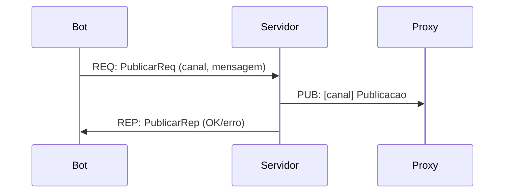
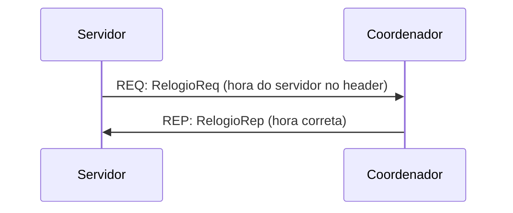
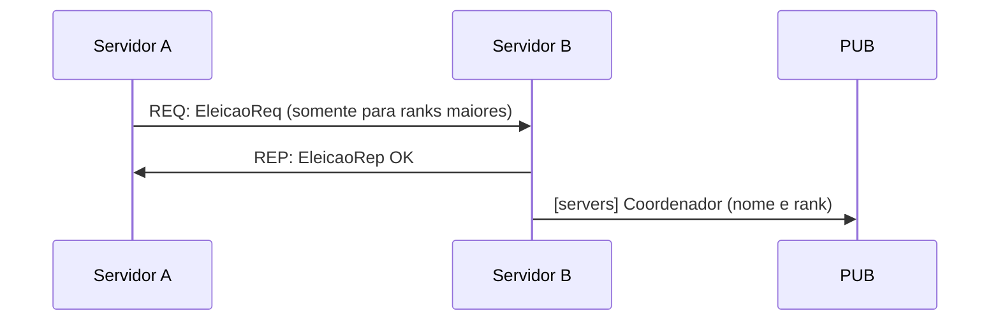
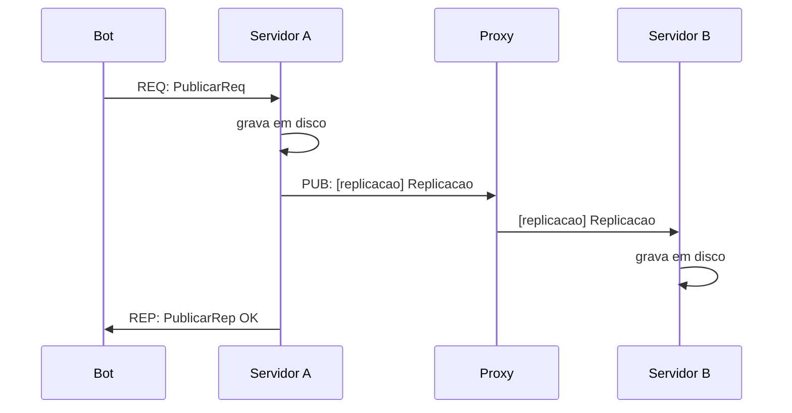

# Sistema de troca de mensagens instantâneas

Projeto da disciplina de Sistemas Distribuídos: uma versão simplificada de um BBS/IRC em que bots fazem login, criam canais e trocam mensagens com servidores usando ZeroMQ.

## Estrutura

```
proto/      definição das mensagens (Protocol Buffers)
servidor/   servidor em Java (Spring Boot)
bot/        cliente (bot) em Python
broker/     broker REQ-REP em Python
proxy/      proxy PUB-SUB em Python
referencia/ serviço de referência em Python
```

## Linguagens

- **Java (Spring Boot)**: servidor
- **Python**: bot, broker, proxy e serviço de referência

## Serialização

As mensagens são serializadas em binário com Protocol Buffers (`proto/messages.proto`). Toda mensagem é enviada dentro de um `Envelope`, que possui um `Header` com o id da mensagem, o remetente, o timestamp do envio e o relógio lógico (`lamport`) de quem envia.

## Comunicação

- `broker`: ROUTER na porta 5555 (clientes) e DEALER na porta 5556 (servidores)
- `proxy`: XSUB na porta 5557 (servidores publicam) e XPUB na porta 5558 (bots se inscrevem)
- `referencia`: REP na porta 5559 (somente servidores)
- cada servidor: REP na porta 5560 para mensagens de outros servidores (relógio e eleição) e SUB no tópico `servers` do proxy

| Requisição | Resposta | Erros possíveis |
|---|---|---|
| `LoginReq` (usa o `remetente` do header) | `LoginRep` | `NOME_INVALIDO` |
| `CriarCanalReq` | `CriarCanalRep` | `NOME_INVALIDO`, `CANAL_JA_EXISTE` |
| `ListarCanaisReq` | `ListarCanaisRep` com a lista de nomes | |
| `PublicarReq` (canal e mensagem) | `PublicarRep` | `NOME_INVALIDO` |

Regras:

- nome de usuário: não pode ser vazio e tem no máximo 32 caracteres
- nome de canal: letras, números, `_` e `-`, com no máximo 32 caracteres
- não é permitido criar dois canais com o mesmo nome
- em caso de erro no login, o bot repete a requisição até conseguir
- mensagem publicada: não pode ser vazia e tem no máximo 280 caracteres

### Publicação em canais



O servidor valida a requisição, grava a publicação em disco, publica no proxy usando o nome do canal como tópico e só então responde ao bot. Assim, o bot só recebe `OK` quando a mensagem foi armazenada e publicada.

A publicação é enviada em duas partes: o tópico (nome do canal) e o `Envelope` com a `Publicacao` (canal, mensagem e autor), cujo header tem o timestamp do envio. Como a inscrição do ZeroMQ funciona por prefixo (quem assina `canal-1` também recebe `canal-10`), o bot confere o campo `canal` da publicação antes de exibi-la.

O servidor não confere se o canal existe antes de publicar: como o broker distribui as requisições entre os servidores, cada um conhece apenas os canais criados nele, e a verificação faria parte das publicações falhar até que os dados sejam replicados.

## Bot

1. faz login no serviço
2. lista os canais disponíveis
3. se existirem menos do que 5 canais, cria um novo com nome aleatório (`canal-N`)
4. se estiver inscrito em menos do que 3 canais, se inscreve em mais um escolhido aleatoriamente
5. escolhe um canal da lista e envia 10 mensagens aleatórias, com intervalo de 1 segundo
6. volta para o passo 2

Enquanto espera o intervalo entre as mensagens, o bot exibe as publicações recebidas nos canais em que está inscrito, com o canal, a mensagem, o horário do envio e o horário do recebimento.

## Relógios e serviço de referência

### Relógio lógico

Bots, servidores e o serviço de referência mantêm um contador de Lamport que começa em 0. Antes de cada envio (requisição, resposta ou publicação), o contador é incrementado e enviado no campo `lamport` do header. Ao receber uma mensagem, o processo passa a usar o maior valor entre o seu contador e o recebido.

### Serviço de referência

| Requisição | Resposta | Uso |
|---|---|---|
| `RankReq` (nome no `remetente`) | `RankRep` com o rank | enviado pelo servidor ao iniciar |
| `ListarServidoresReq` | `ListarServidoresRep` com nome e rank | lista dos servidores disponíveis |
| `HeartbeatReq` (nome no `remetente`) | `HeartbeatRep` com `OK` | a cada 10 mensagens de clientes |

- o rank é sequencial (1, 2, 3...) na ordem do primeiro contato e não muda se o mesmo nome se cadastrar de novo
- um servidor que fica 30 segundos sem enviar heartbeat é removido da lista de disponíveis e volta a ela no próximo heartbeat

### Coordenador e sincronização do relógio físico (Berkeley)

A cada 15 mensagens de clientes, o servidor pede a hora ao coordenador:



O coordenador aplica o algoritmo de Berkeley usando a hora que vem no header de cada pedido:

1. guarda a diferença entre a hora do servidor e a sua
2. calcula a média das diferenças de todos os servidores ativos, contando a dele como 0
3. ajusta o próprio relógio pela média e responde com a nova hora, que o servidor passa a usar

Assim, todos os relógios convergem para a média, e não para o relógio de um único processo. Para que a sincronização apareça na execução, o compose inicia os servidores com relógios desajustados (`CLOCK_DRIFT_MS`: -1500 ms no `servidor-1` e +2500 ms no `servidor-2`). Os logs `[berkeley] media de N ms` (no coordenador) e `[relogio] ajuste de N ms` (nos demais) mostram as correções.

### Eleição (algoritmo do valentão)

O coordenador é o servidor disponível com o maior rank. Uma eleição começa quando o servidor inicia, quando o coordenador não responde ao pedido de relógio ou quando chega um pedido de eleição:



- o servidor envia `EleicaoReq` para todos os servidores da lista com rank maior que o seu
- quem recebe responde `OK` e inicia a sua própria eleição
- se ninguém responder em 2 segundos, o servidor se declara coordenador e publica o seu nome e rank no tópico `servers`
- todos os servidores guardam o nome anunciado em `servers`; se o anúncio vier de um rank menor que o seu, o servidor inicia uma nova eleição
- o coordenador repete o anúncio a cada 15 mensagens, para que servidores que perderam o anúncio (por exemplo, ao reiniciar) fiquem sabendo

As mensagens entre servidores são atendidas em uma thread separada, para que um servidor consiga responder outro mesmo enquanto espera uma resposta.

### Tempo limite das requisições

- requisições entre servidores e para a referência esperam até 1,5 segundo e são tentadas 2 vezes, recriando o socket entre as tentativas; sem resposta, o servidor considera o destino indisponível e segue atendendo os clientes
- o bot espera até 10 segundos pela resposta; sem resposta (por exemplo, se o servidor que recebeu a requisição caiu), ele recria o socket e reenvia a requisição

## Replicação

### Problema

O broker distribui as requisições dos bots entre os servidores (round-robin), então cada servidor recebe só uma parte dos logins, canais e publicações. Se um servidor para, essa parte do histórico fica inacessível, e um bot que lista os canais vê apenas os canais do servidor que respondeu.

### Método escolhido: replicação ativa com propagação assíncrona

Todos os servidores aceitam escritas, e cada escrita é enviada a todas as outras réplicas:



1. ao gravar um login, um canal ou uma publicação recebidos de um bot, o servidor publica uma mensagem `Replicacao` (tipo, usuário, canal, mensagem e timestamp) no tópico `replicacao` do proxy
2. todos os servidores assinam o tópico `replicacao` e gravam os registros recebidos de outros servidores, ignorando os que eles mesmos enviaram
3. ao iniciar (ou voltar depois de uma queda), o servidor pede o histórico completo a outro servidor disponível da lista da referência (`HistoricoReq`/`HistoricoRep` na porta 5560) e grava os registros que ainda não tem

Com isso, todos os servidores ficam com todos os dados: um bot pode ser atendido por qualquer servidor e a queda de um deles não faz perder o histórico.

### Mudanças em relação ao método visto em aula

- **sem ordem total:** na replicação ativa clássica, as operações precisam chegar a todas as réplicas na mesma ordem (multicast totalmente ordenado). Aqui isso não é necessário porque as operações só acrescentam registros (nenhum login, canal ou publicação é alterado ou removido), então aplicar os mesmos registros em qualquer ordem leva ao mesmo conjunto de dados. Para exibir o histórico em ordem, basta ordenar pelo timestamp de cada registro.
- **consistência eventual:** a resposta ao bot não espera as outras réplicas gravarem. Por alguns milissegundos, um registro novo pode existir em um servidor e ainda não no outro.
- **sem duplicatas:** antes de gravar, o servidor compara o registro com os que já tem (todos os campos). Receber o mesmo registro pela replicação e pelo histórico não gera linhas repetidas.
- **canais criados ao mesmo tempo:** se dois bots criam o mesmo canal em servidores diferentes antes de a replicação chegar, os dois registros são mantidos em todos os servidores, e a listagem mostra o nome uma única vez.
- **transferência de estado:** foi adicionado o pedido de histórico ao iniciar, porque um servidor que estava desligado não recebe as publicações do tópico `replicacao` enviadas nesse intervalo.

### Adicionando um servidor

Basta acrescentar um serviço no `docker-compose.yaml` com `SERVER_NAME` igual ao nome do serviço (por exemplo, `servidor-3`) e executar `docker compose up -d servidor-3`, sem parar os outros containers. O novo servidor recebe um rank da referência, participa das eleições, passa a receber requisições do broker e copia o histórico de outro servidor.

## Persistência

Cada servidor grava seus dados no diretório definido por `DATA_DIR` (mapeado para `dados/<nome-do-servidor>` no compose), sem compartilhar arquivos com os outros servidores (o conteúdo é igualado pela replicação). O formato é JSON Lines, com um registro por linha, sempre anexado ao final do arquivo:

- `logins.jsonl`: usuário e timestamp de cada login
- `canais.jsonl`: nome do canal, usuário que criou e timestamp da criação
- `publicacoes.jsonl`: canal, mensagem, autor e timestamp de cada publicação

Como cada registro é uma linha JSON completa, todo o histórico pode ser recuperado lendo o arquivo do início ao fim.

## Execução

```
docker compose up --build
```

Nos primeiros segundos, algumas publicações podem não chegar aos bots: no ZeroMQ, o PUB descarta mensagens enviadas antes de a inscrição do SUB chegar até ele (*slow joiner*).

## Verificação automática

```
./testes/verificar.sh
```

O script sobe todo o projeto em um ambiente separado (projeto `bbsteste`, dados em `testes/dados`), executa um cliente de teste dentro da rede do compose e verifica, parte por parte:

- login, criação e listagem de canais, incluindo os erros
- publicação e recebimento pelo pub/sub, com filtro por canal
- relógio lógico, serviço de referência, heartbeat e Berkeley
- eleição: derruba o coordenador, confere que outro assume e que os bots continuam sendo atendidos
- replicação: religa o servidor derrubado, adiciona um `servidor-3` e confere que todos terminam com os mesmos dados

Ao final, mostra quantas verificações passaram e salva os logs em `testes/logs`. Leva cerca de 2 minutos.
