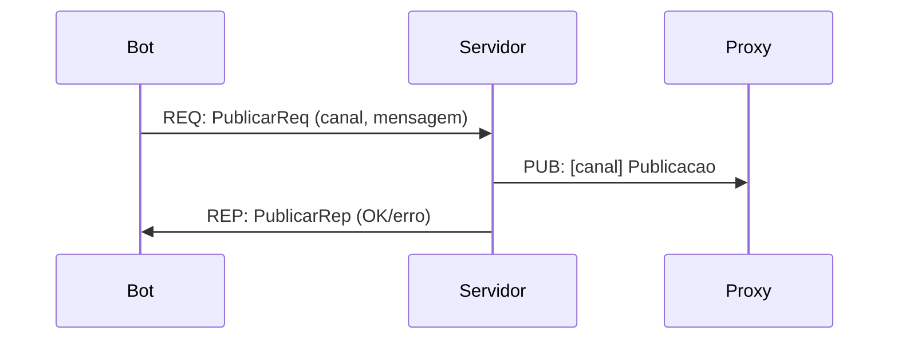

# Sistema de troca de mensagens instantâneas

Projeto da disciplina de Sistemas Distribuídos: uma versão simplificada de um BBS/IRC em que bots fazem login, criam canais e trocam mensagens com servidores usando ZeroMQ.

## Estrutura

```
proto/      definição das mensagens (Protocol Buffers)
servidor/   servidor em Java (Spring Boot)
bot/        cliente (bot) em Python
broker/     broker REQ-REP em Python
proxy/      proxy PUB-SUB em Python
```

## Linguagens

- **Java (Spring Boot)**: servidor
- **Python**: bot, broker e proxy

## Serialização

As mensagens são serializadas em binário com Protocol Buffers (`proto/messages.proto`). Toda mensagem é enviada dentro de um `Envelope`, que possui um `Header` com o id da mensagem, o remetente e o timestamp do envio.

## Comunicação

- `broker`: ROUTER na porta 5555 (clientes) e DEALER na porta 5556 (servidores)
- `proxy`: XSUB na porta 5557 (servidores publicam) e XPUB na porta 5558 (bots se inscrevem)

| Requisição | Resposta | Erros possíveis |
|---|---|---|
| `LoginReq` (usa o `remetente` do header) | `LoginRep` | `NOME_INVALIDO` |
| `CriarCanalReq` | `CriarCanalRep` | `NOME_INVALIDO`, `CANAL_JA_EXISTE` |
| `ListarCanaisReq` | `ListarCanaisRep` com a lista de nomes | |
| `PublicarReq` (canal e mensagem) | `PublicarRep` | `NOME_INVALIDO` |

Regras:

- nome de usuário: não pode ser vazio e tem no máximo 32 caracteres
- nome de canal: letras, números, `_` e `-`, com no máximo 32 caracteres
- não é permitido criar dois canais com o mesmo nome
- em caso de erro no login, o bot repete a requisição até conseguir
- mensagem publicada: não pode ser vazia e tem no máximo 280 caracteres

### Publicação em canais



O servidor valida a requisição, grava a publicação em disco, publica no proxy usando o nome do canal como tópico e só então responde ao bot. Assim, o bot só recebe `OK` quando a mensagem foi armazenada e publicada.

A publicação é enviada em duas partes: o tópico (nome do canal) e o `Envelope` com a `Publicacao` (canal, mensagem e autor), cujo header tem o timestamp do envio. Como a inscrição do ZeroMQ funciona por prefixo (quem assina `canal-1` também recebe `canal-10`), o bot confere o campo `canal` da publicação antes de exibi-la.

O servidor não confere se o canal existe antes de publicar: como o broker distribui as requisições entre os servidores, cada um conhece apenas os canais criados nele, e a verificação faria parte das publicações falhar até que os dados sejam replicados.

## Bot

1. faz login no serviço
2. lista os canais disponíveis
3. se existirem menos do que 5 canais, cria um novo com nome aleatório (`canal-N`)
4. se estiver inscrito em menos do que 3 canais, se inscreve em mais um escolhido aleatoriamente
5. escolhe um canal da lista e envia 10 mensagens aleatórias, com intervalo de 1 segundo
6. volta para o passo 2

Enquanto espera o intervalo entre as mensagens, o bot exibe as publicações recebidas nos canais em que está inscrito, com o canal, a mensagem, o horário do envio e o horário do recebimento.

## Persistência

Cada servidor grava seus dados no diretório definido por `DATA_DIR` (mapeado para `dados/<nome-do-servidor>` no compose), sem compartilhar arquivos com os outros servidores. O formato é JSON Lines, com um registro por linha, sempre anexado ao final do arquivo:

- `logins.jsonl`: usuário e timestamp de cada login
- `canais.jsonl`: nome do canal, usuário que criou e timestamp da criação
- `publicacoes.jsonl`: canal, mensagem, autor e timestamp de cada publicação

Como cada registro é uma linha JSON completa, todo o histórico pode ser recuperado lendo o arquivo do início ao fim.

## Execução

```
docker compose up --build
```

Nos primeiros segundos, algumas publicações podem não chegar aos bots: no ZeroMQ, o PUB descarta mensagens enviadas antes de a inscrição do SUB chegar até ele (*slow joiner*).
